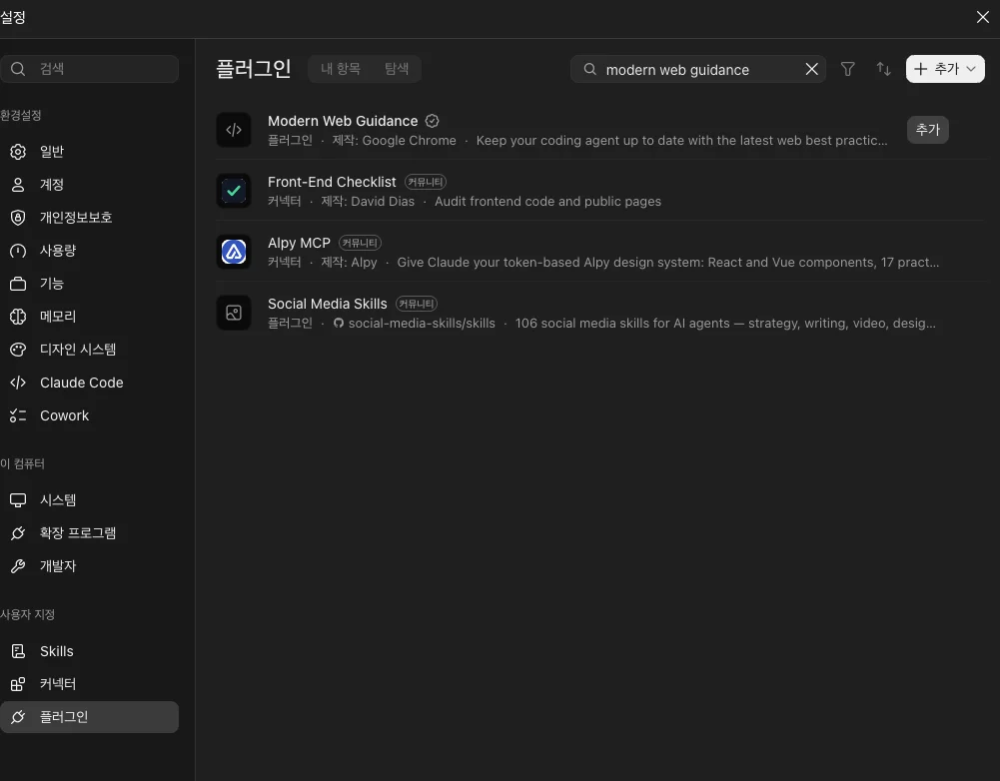
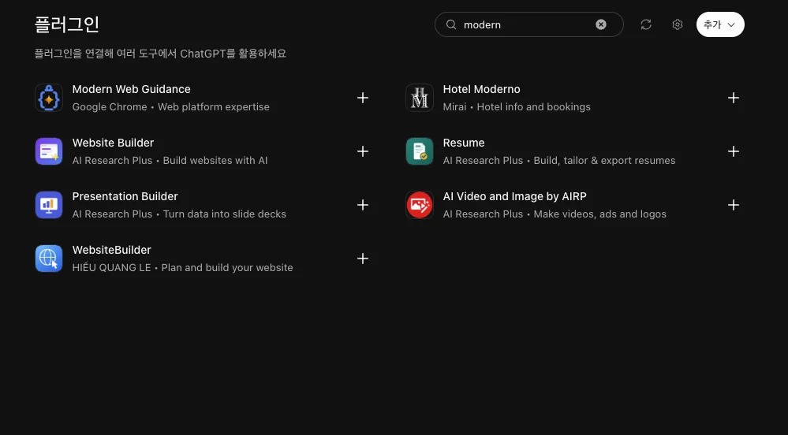

# Modern Web Guidance - AI 에이전트에게 최신 웹 가르치기

## 들어가며

[Modern Web Guidance](https://developer.chrome.com/docs/modern-web-guidance?hl=ko)는 구글 크롬 팀이 만든 도구로

웹사이트를 만들 때 AI가 최신 방식을 쓰고 권장사항을 따르도록 합니다.

코딩 에이전트에 삽입하는 웹 플랫폼 전문 지식, 권장사항, 브라우저 호환성에 대한 기술 모음입니다.

## 왜 사용해야 할까

요즘은 AI에게 "이런 페이지 하나 만들어줘" 라고 하면 금방 만들어 주지만

그 코드를 보면 오래된 방식으로 작성된 경우가 많습니다.

브라우저는 해마다 새 기능을 넣지만

AI가 배운 코드에는 그 기능이 없던 시절의 코드가 더 많습니다.

그래서 AI는 '오래된 흔한 방식' 으로 작성합니다.

<br>

Modern Web Guidance는 AI에게 가이드를 줍니다.

AI는 코드를 작성하기 전에 가이드를 확인합니다.

## 설치하기

권장되는 설치 방법은 크롬 팀에서 빌드한 CLI를 사용하는 것입니다.

터미널에 아래 한 줄을 붙여넣으면 됩니다.

```bash
npx modern-web-guidance@latest install
```

<br>

사용중인 도구에 맞춰 설치할 수도 있습니다.

**Claude Code**

```bash
claude plugin marketplace add GoogleChrome/modern-web-guidance
claude plugin install modern-web-guidance@googlechrome
```

앱의 설정 > 플러그인에서 추가할 수도 있습니다.



**Codex**

```bash
codex plugin marketplace add GoogleChrome/modern-web-guidance
codex plugin add modern-web-guidance@googlechrome
```

앱의 플러그인 화면에서 추가할 수도 있습니다.



## 브라우저 지원

최신 기능이 항상 좋은 건 아닙니다.

크롬에서는 작동하지만 사파리에서는 작동하지 않는 기능이 있습니다.

브라우저가 지원하더라도 업데이트하지 않은 사용자가 남아 있습니다.

<br>

AI는 이걸 모르는 채로 코드를 작성합니다.

그냥 써도 되는 기능을 다시 만들거나

최신 기능을 써서 구형 브라우저에서 화면이 망가집니다.

<br>

Modern Web Guidance는 기능마다 브라우저 지원 현황을 같이 넘겨줍니다.

지금 써도 되는 기능인지, 대체 기능이 필요한지 AI가 판단할 수 있습니다.

<br>

어디까지 받아들일지 직접 정할 수도 있습니다.

`AGENTS.md` 나 `CLAUDE.md` 에 한 줄 적어두면 됩니다.

```md
This project's Baseline target is Baseline 2024.
```

`Baseline` 은 브라우저 지원 현황을 정리해둔 웹 표준 기준입니다.

## Modern Web Guidance에 무엇이 있나요?

Modern Web Guidance에는 100개 이상의 웹 개발에 관한 권장사항이 포함되어 있습니다.

- 사용자 환경: 뷰 전환, CSS scrollbar-color 스타일 지정, 들어가기 및 나가기 애니메이션
- CSS: 컨테이너 쿼리, oklch와 같은 최신 색상 공간, CSS 하위 그리드 레이아웃, text-wrap, 서체 줄 높이 자르기
- 성능: 다음 페인트에 대한 상호작용(INP) 진단, 긴 작업 분할을 위한 scheduler.yield, 백그라운드 작업 예약, 이미지 로드 우선순위 지정
- 양식: 자동 크기 조절 입력란(field-sizing: content) 및 :user-invalid를 사용한 정확한 유효성 검사 스타일
- 기본 제공 UI 구성요소: 대화상자 직접 제어, 도움말의 CSS 앵커 포지셔닝, popover
- 접근성: 액세스 가능한 오류 알림 및 키보드 포커스 관리
- 내장 AI: 로컬 기기 내 클라이언트 모델(네이티브 언어 감지, 요약, 번역 API)을 사용합니다.
- 패스키: 패스키 등록, 인증, 관리

<br>

## 이미 있는 낡은 코드 손보기

이미 만들어둔 코드를 현대화 할 수 있습니다.

```bash
npx modern-web-guidance legacy-scan <path> --json
```

프롬프트를 이렇게 작성하면 됩니다.

```
Modernize this repository using Modern Web Guidance.
Scan our frontend files for legacy patterns, verify the findings,
and propose a modernization plan before making any code edits.
```

---

- [Modern Web Guidance 문서](https://developer.chrome.com/docs/modern-web-guidance?hl=ko)
- [GitHub 저장소](https://github.com/GoogleChrome/modern-web-guidance)
- [Modern Web Guidance 1.0: 코딩 에이전트에 부족한 웹 플랫폼 전문성](https://developer.chrome.com/blog/modern-web-guidance-v1?hl=ko)
- [웹 개발에서 AI가 잘못하는 10가지](https://developer.chrome.com/blog/top-10-things-ai-gets-wrong-in-web-dev?hl=ko)
- [기본적으로 교차 브라우저: Modern Web Guidance에서 Baseline 대체가 작동하는 방식](https://developer.chrome.com/blog/cross-browser-by-default?hl=ko)
- [코딩 에이전트를 위한 로컬 벡터 검색: 507MB에서 7줄 루프로](https://developer.chrome.com/blog/mwg-technical-deep-dive?hl=ko)
